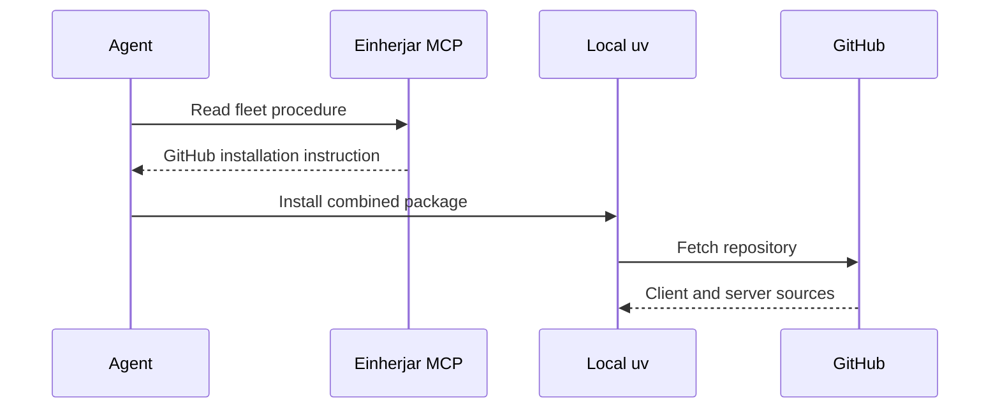
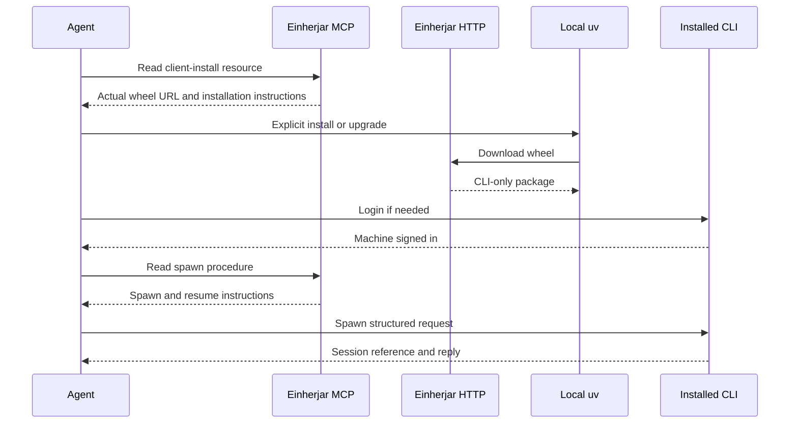

# High Wizard Plan

## **PROJECT INFO**
- **Project**: einherjar-server (related: agent-memory-fleet, einherjar-deploy)
- **Date**: 2026-11-09
- **Agent**: software-architect
- **Theme**: Separate the local CLI package and distribute it through HTTP, discoverable through MCP.
- **Source Protocol**: `/high-wizard` — /high-wizard

*CRITICAL INSTRUCTION: To continue this plan: load the source protocol above, then inspect which sections below are filled vs unfilled to infer your current step.*

---

## **INHERITED CONTEXT**
*Filled at investigation step 0 with whatever was settled before this plan existed. The two sources are recorded separately and never merged — write "None" under a part that does not apply.*
*These decisions are **not yours to reopen**. If one looks wrong, STOP and surface it to [USER-NAME] — do not silently re-decide it here or in Confirmed Decisions below.*

### From the Parent Plan
- **Parent plan**: None — not a sub-plan.
- **Assigned scope**: None.
- **Integration contracts**: None inherited from a parent.
- **Pushed-down open items**: None.

### From Pre-Planning Discussion
- **Discussion**: Pre-planning discussion with Alvi, 2026-11-09.
- **Agreed scope**: Separate CLI packaging from the server; supply the installable CLI through an HTTP API endpoint; expose an MCP resource that supplies the HTTP download link and installation instructions; correct the MCP procedures' GitHub install guidance. Use High Wizard.

| # | Settled decision | Chosen | His reason | Status |
|---|------------------|--------|------------|--------|
| 1 | Separate CLI and server packaging | Separate installable CLI package without server dependencies | "yes, we need to separate it ofc." | Settled |
| 2 | Download source | Einherjar HTTP API, not GitHub | "the MCP proceduers should mention to download from API http resources" | Settled |
| 3 | MCP discovery | Text resource pointing at the HTTP download and installation instructions | "I do remember that we need to have that link available as both MCP resources and API resources. but since MCP resources will just give the whole text to agent, the MCP resource should just instruct agent from the API resources." | Settled |
| 4 | Planning procedure | High Wizard | "go" in response to the recommendation to use High Wizard for the package split and release chain | Settled |

- **Considered and rejected**: GitHub as the user-facing CLI installation source; serving the wheel contents as MCP text; leaving CLI and server dependencies in one installable package; Quick Wizard for this multi-component release.
- **Left open**: Package placement/names and migration, HTTP download access and version selection, build/distribution mechanics, production release boundary and verification.

---

## **OBJECTIVES**
Deliver a separately installable local Einherjar CLI through the server's public HTTP API, discoverable through an MCP installation resource. Correct fleet installation guidance and add the missing served `/spawn` procedure, then deploy and migrate this machine using the HTTP artifact.

### **Related Documents**
- [Product README](../README.md) — current package and CLI behavior.
- [Package metadata](../pyproject.toml) — currently combines server and client dependencies.
- [Fleet procedures](../agent-memory-fleet/procedures/) — served instructions to update.
- [Image build](../.github/workflows/build-image.yml) — current artifact publishing pipeline.

### **SUCCESS CRITERIA**
- [ ] CLI installs without server libraries, database drivers, or server entrypoints.
- [ ] Server and CLI are separate Python distributions in one repository, without a new submodule.
- [ ] Public HTTP download serves the built CLI wheel bundled with the running server; no GitHub URL is required for user installation.
- [ ] MCP installation resource describes prerequisites, current HTTP download, installation/upgrade, and separate CLI login; it does not return wheel contents.
- [ ] `/spawn` is discoverable through MCP and explains anonymous foreground/background creation, result retrieval, and resume through `ask`.
- [ ] Existing named awakening, resume, background execution, credentials, machine identity, pending records, and session references remain usable.
- [ ] Unit, package-isolation, and download/install checks pass; static quality review and QA handoff are recorded.
- [ ] Updated fleet content and product image are published and deployed; this machine installs the CLI from the live HTTP download.

---

## **SCOPE**

### In Scope
- Separate client and server packages/dependencies in the existing product repository, with separate entrypoints and clean-environment installation checks.
- Build the client wheel and bundle it with the server image; expose it through public HTTP and describe it with an MCP text resource.
- Serve only the artifact bundled with the running server; explicit user-triggered installation/updates, no automatic updater.
- Correct current fleet procedures and README installation guidance and add the missing `/spawn` procedure and its discovery/tests.
- Preserve runtime authentication for private session APIs and the existing local credential/state locations.
- CI/image changes, fleet submodule pin, product and deployment publication, live download verification, and local migration.

### Out of Scope
- A separate client repository or Git submodule.
- Authenticated download/bootstrap installers, automatic updates, or retaining a public catalog of historical CLI releases.
- Native standalone binaries, bundling Python/uv/the model harness, or removing the need for a local OpenCode/Claude Code installation.
- Moving agent execution or conversation history onto the cloud server, changing the registry schema, or changing wrap-up semantics.
- Changing repository visibility or adding IP-protection mechanisms.

---

## **CONFIRMED DECISIONS**
*Decisions made **by this plan** — both **asked-and-confirmed** by [USER-NAME] AND **written-through** (Zone A and B decisions made by the agent, recorded with their reasoning). The reasons serve as the analysis record.*
*Decisions settled before this plan existed — by a parent, or in a pre-planning discussion — belong in [INHERITED CONTEXT](#inherited-context) above, not here. Keeping them separate is what shows which decisions this plan actually owns.*

| # | Decision | Chosen | Reason |
|---|----------|--------|--------|
| 1 | Delivery boundary | Build, test, publish, deploy, and migrate this machine | Alvi chose scope A so the HTTP download is usable and proven, not merely implemented. |
| 2 | Download authentication | Public download; CLI login still protects private APIs | Alvi changed to A after confirming both source repositories are public; an extra download login would not protect the code. |
| 3 | Updates | Explicit installation/upgrade only | Alvi chose A for now; no automatic checks or updates. |
| 4 | Package placement | Separate Python packages in the existing repository, ordinary directories | Alvi reaffirmed A after discussing that a submodule is a separate repository with another pin/release step. |
| 5 | Artifact availability | Only the wheel bundled with the running server | Alvi chose A; no persistent historical artifact store is needed. |
| 6 | Artifact production and consumption | Build the CLI wheel and bundle it in the server image; serve its bytes over HTTP and expose instructions through MCP | This keeps the advertised artifact tied to the deployed release without a separate artifact service. |
| 7 | Missing agent-facing command | Add served `/spawn` procedure | Alvi explicitly requested it so agents can discover how to use the already-built CLI command. |
| 8 | Existing behavior | Keep command spelling, runtime sign-in, credential/state paths and session refs usable | Package delivery must not silently become a state migration or an agent-execution rewrite. |
| 9 | Distribution/import identity | CLI: `einherjar` / `einherjar_cli`; server: `einherjar-server` / `einherjar` | Preserves the existing installed tool name and server import package while ensuring separate files and executable ownership. |
| 10 | Artifact metadata | Derive version, filename, size and SHA-256 from the built wheel | HTTP and MCP must describe the bytes actually served, never a handwritten version or guessed filename. |
| 11 | Stable discovery | HTTP `/v1/resources/cli`; MCP `resource://client/install` / `client-install` | Stable discovery points to the current versioned wheel without promising historical downloads survive a deployment. |
| 12 | Native-client refresh-token fix | Add `prompt=consent` to authorization requests; re-login and verify a real refresh after HTTP migration | Explicitly approved by Alvi after the read-only investigation: installed CLI omits consent, live Logto check_scope removes offline_access without it, and today's exchange issued only AccessToken/IdToken. Dynamic-client compatibility injection does not cover this pre-registered native client. |

---

## **SOLUTION**

### Architecture Overview
Keep the server at the repository root and add `packages/cli/` as a uv workspace member. Each has its own package metadata and runtime dependencies. The shared development environment installs both for the test suite, but neither package depends on the other in production. Clean-environment wheel tests prove that workspace convenience does not hide cross-package imports.

The server image builds and carries the CLI wheel as a downloadable artifact, not an installed dependency. One artifact reader derives metadata from the built wheel for both HTTP and MCP. Fleet-authored procedures stay in the existing content submodule; add `/spawn` and replace active GitHub installation guidance with the MCP client-install resource and HTTP discovery URL.

### Packages and migration
| Package | Distribution/import names | Runtime and entrypoint |
|---|---|---|
| Root server | `einherjar-server` / `einherjar` | Server dependencies; `einherjar-server` and server-only `python -m einherjar` |
| `packages/cli/` | `einherjar` / `einherjar_cli` | `httpx`, `keyring`; only the `einherjar` executable |

- Keeping the CLI distribution name `einherjar` lets `uv tool install --force <wheel URL>` replace the existing combined tool rather than collide with it. Both packages start at `0.1.6`; thereafter increment the changed distribution independently. The server never assumes the CLI version equals its own.
- Move client `cli`, `settings`, `install`, `registry/client`, `state`, `transport`, and OAuth login/PKCE/token storage into the CLI package. Leave OAuth token verification in the server.
- Detached turns become `python -m einherjar_cli _turn <payload>`, with a client-only `__main__` that never imports server dependencies.
- Preserve environment variables, keyring service/account, credential/state paths, machine identity, pending-row formats, registry contract `1`, and session references. The client wheel must not expose `einherjar-server`.
- Copy license/notice bytes verbatim into the client package. Explicit uv_build module names bridge the distribution/import naming differences. Root development dependencies include the workspace CLI; server production dependencies do not.

### Integration Architecture
| Producer | Consumer | Contract |
|---|---|---|
| CLI build | Server image | Exactly one client-only wheel in the configured artifact directory |
| Artifact reader | HTTP and MCP | Actual wheel name, version, size, SHA-256, current URL and install command |
| HTTP artifact endpoint | Local uv | Public wheel attachment, no redirect to GitHub |
| MCP client-install resource | Agent/fleet procedures | Text instructions pointing to HTTP, never wheel bytes |
| Installed CLI | Model harness and registry API | Existing local execution, OAuth and tracking contracts |
| Fleet content | Server loader | Verbatim procedures, now including `/spawn` |

### HTTP and MCP resources
- `GET /v1/resources/cli`: public JSON discovery with package, version, filename, size, SHA-256, absolute download URL and exact `uv tool install --force` command. Discovery is non-cacheable so it does not advertise the previous deployment's wheel.
- `GET /v1/resources/cli/{filename}`: public attachment of the one current wheel. Resolve only by exact equality to the validated filename, never arbitrary path concatenation. Unknown filename: 404. Missing, corrupt or multiple artifacts: 503 with an actionable message. No registry database dependency and no change to private-route authentication.
- Add server setting `EINHERJAR_CLI_DIST_DIR`; default to a local artifact directory, inject its absolute location in Docker. Local development explicitly builds the wheel there. Absence must not break unrelated registry/health tests but must never yield a fabricated install link.
- Add MCP resource `resource://client/install`, name `client-install`, and expose the same text through `list_resources` / `read_resource("client-install")`. Preserve template resources and all existing tools.
- Generate install text from the same artifact reader: prerequisites (Python 3.12+, uv, local model harness), metadata URL, actual current versioned wheel URL/hash, install and explicit upgrade, replacement of the combined package, harness setup and separate CLI login. Missing artifact returns unavailable guidance, not a guessed version or binary payload.

### Spawn procedure
Add `agent-memory-fleet/procedures/spawn.md`; existing prompt discovery and `read_procedure("spawn")` serve it. Document client-install prerequisites, the Theme/Context/Request/Expected Output prompt form, foreground and `--background`, `--model`/`--theme`, `result <ref>`, and `ask <ref>` for continuation. No fleet agent name or awakening is supplied; platform/project instructions still apply. Do not run overlapping turns against a background session. A successful turn is not a memory wrap-up; anonymous sessions have no presumed fleet identity. Update fleet help/discovery and README alongside the existing procedures' install prerequisites. Historical plans remain historical.

### Cross-System Contract Impact
Additive HTTP/MCP resource contracts; changed Python package and executable ownership; unchanged registry schema, auth and turn payloads.

| Consumer | Risk | Verification |
|---|---|---|
| Existing uv tool | Duplicate executable or wrong package replacement | Preserve distribution/command name; inspect installed provenance and scripts after HTTP migration |
| Detached turns | Old module starts a server or imports server dependencies | Assert new module argv; exercise client module in isolated environment |
| Server Docker/CI | Workspace metadata absent from cache stage; CLI accidentally installed in runtime | Copy manifests before frozen sync; inspect isolated server install and image build |
| MCP clients | Tool wrappers omit resource or spawn | Native resource/tool parity, prompt discovery, live read-back |
| HTTP/uv installation | Metadata names bytes not actually served | Derive fields from actual wheel; hash download; clean installation |
| Registry/auth | Moved code changes identity/state names | Existing PostgreSQL tests and credential/state regression checks |

Deploy order: commit fleet content, pin it in product, publish tested image, update deployment pointer, deploy exact image, inspect live resource/download, then replace local tool from live HTTP. No data migration. Record local state using existence/hashes only, never token contents. No existing consumer registry was found; this table records this change's consumers.

### System Flow Diagrams
**Current:**

**After delivery:**

### Technical Considerations
- uv workspaces share a lockfile but do not enforce import isolation. Build both wheels and install them in separate temporary environments; client must lack FastAPI/FastMCP/psycopg/uvicorn, server must lack CLI module/script.
- Artifact reader validates the wheel and derives its metadata/hash from the actual bytes. Exact-name routing prevents arbitrary file reads. TLS and SHA-256 check integrity, not secrecy of public code.
- Only the running server's wheel is downloadable. Previously advertised filenames can become unavailable after deployment; stable metadata/MCP discovery supplies the current one. Installed clients do not auto-update.
- Dependencies still download from Python package indexes. This is not an offline distribution or a Python/uv/model-harness bundle.
- Public downloads do not change OAuth protection on MCP or registry routes. No bootstrap login is needed; normal CLI login follows installation.
- Preserve source bytes when moving modules and change only imports/entrypoints needed by the new package boundary. Source licenses are copied, not regenerated.
- This workstation's SSH attempt was refused; the deployment workflow has its own key. Verify release logs and live HTTP/MCP, not an unsupported claim of direct container inspection.

---

## **IMPLEMENTATION PHASES**

### Phase 1: Separate packages
- [x] **Step 1.1**: Extract CLI and isolate distributions. (crosses: filesystem/package build)
  - **Action**: Create client workspace member; move client modules, update imports/entrypoints/tests/versions/lockfile and license inputs.
  - **Implementation**: Server stays under `einherjar`; client becomes `einherjar_cli`; production dependencies are independent, development installs both.
  - **Testing**: Existing CLI/auth/state/transport/server tests, lint, both wheel builds and isolated dependency/script/import/help checks.
  - **Success Criteria**: Both packages build independently; CLI keeps command/state contracts without server dependencies.

### Phase 2: HTTP artifact and MCP resource
- [x] **Step 2.1**: Add artifact reader and public routes. (crosses: filesystem/HTTP)
  - **Action**: Derive metadata and serve discovery plus the exact current filename from configured artifact directory.
  - **Implementation**: Validated wheel metadata and byte-derived hash; public FileResponse, 404 unknown filename, 503 unavailable/corrupt/ambiguous artifact.
  - **Testing**: Real temporary wheel fixtures; metadata/hash/header/byte equality; missing/corrupt/multiple artifacts, unknown/traversal paths and unchanged anonymous refusal on private APIs.
  - **Success Criteria**: Only the actual current CLI artifact is advertised/served; no arbitrary file read or auth weakening.
- [x] **Step 2.2**: Expose client-install resource through native MCP and tools.
  - **Action**: Register resource and add to list/read wrappers without altering template content.
  - **Implementation**: Generate instructions from the same distribution reader and configured public base URL.
  - **Testing**: Native/tool parity, listings, actual version/URL/hash, unavailable behavior and no binary/base64 payload.
  - **Success Criteria**: Agents discover correct installation instructions without a clone or package contents in context.

### Phase 3: Fleet instructions and release build
- [x] **Step 3.1**: Add spawn and correct active installation guidance. (crosses: fleet submodule)
  - **Action**: Add `/spawn`, update fleet help/discovery, procedures and READMEs; preserve historical records.
  - **Implementation**: Existing loader/compiler serves spawn; active installation instructions use client-install and HTTP metadata, not GitHub.
  - **Testing**: Fleet compile and all-procedure fidelity; spawn foreground/background/results/resume/limits coverage; grep active docs for obsolete install commands.
  - **Success Criteria**: Spawn is discoverable and active guidance uses HTTP distribution.
- [x] **Step 3.2**: Build and verify CLI wheel in CI/image. (crosses: package installer/container build)
  - **Action**: Update Dockerfile/CI for workspace metadata, wheel production and clean-package checks; retain PostgreSQL-backed suite.
  - **Implementation**: Build exactly one wheel into configured artifact directory; no CLI runtime dependency in server; exclude generated local state from image context.
  - **Testing**: Local isolated installs, full tests/lint, image build and CI against PostgreSQL; inspect wheel and server package ownership.
  - **Success Criteria**: Published image carries tested CLI-only artifact and runs server independently.

- [ ] **Step 3.3**: Fix explicit offline-access consent before publication. (crosses: OAuth issuer during post-deploy verification)
  - **Action**: Add `prompt=consent` to the CLI authorization-code request; pin it with regression tests. No issuer configuration change.
  - **Implementation**: Preserve scope, PKCE, resource/audience, state and redirect; request offline consent explicitly for this native client. Correct active guidance claiming this client never receives refresh tokens.
  - **Testing**: Query-string and login-flow regressions, existing refresh/retention tests. After Step 4.2, re-login with the new HTTP-installed client, inspect only refresh-token presence, then perform an actual refresh and prove registry access with the newly issued token.
  - **Success Criteria**: Consent is requested and local tests pass before publication; live re-minted credentials include a refresh token and a real refresh works. Browser interaction is a user gate, not a reason to claim the live fix prematurely.

### Phase 4: Publish, deploy and migrate
- [ ] **Step 4.1**: Publish and deploy exact tested release. (crosses: GitHub/registry/production HTTP and MCP)
  - **Action**: Publish fleet, pin product content, commit product/plan, wait for CI/image, update deploy pointer and dispatch deployment.
  - **Implementation**: Existing workflow `version=<short SHA>` and `command=deploy`; capture dispatch run ID and inspect cutover log, never deploy a red/unbuilt ref.
  - **Testing**: Exact-commit CI including PostgreSQL, published image, deploy success, live health/public metadata/download/hash/404 and authenticated MCP resource/spawn read-back.
  - **Success Criteria**: Production serves the tested wheel and matching instructions.
- [ ] **Step 4.2**: Migrate local tool from live HTTP. (crosses: HTTP/local installer/state)
  - **Action**: Fingerprint non-secret local state, replace old combined tool using advertised install command, inspect installed provenance and entrypoints.
  - **Implementation**: `uv tool install --force` exact current wheel; preserve credentials/machine-id/pending/history and harness configuration.
  - **Testing**: HTTP provenance, current version/hash, no server dependencies/script, spawn/ask/login/help and unchanged state fingerprints.
  - **Success Criteria**: Local CLI-only package comes from HTTP and existing identity/state remains usable. No real model turn is implied by package/help checks.

### Phase 5: Review and handoff
- [ ] **Step 5.1**: Static quality review and QA handoff.
  - **Action**: Run embedded analyze-code-quality against logged scope and generate-qa-checklist gate; record evidence and resolve in-scope defects.
  - **Implementation**: Reconcile git status per repository; distinguish formal bench coverage from artifact tests/live observations.
  - **Testing**: Rerun tests/lint after fixes; publish/deploy changed runtime artifacts if necessary; verify saved remote refs.
  - **Success Criteria**: No unaddressed in-scope defect or silent QA skip. Archive only after explicit Alvi sign-off.

---
## **EXECUTION LOG**
**Execution Protocol for AI**:
I have to use this document as my **ONLY** source of truth to execute and track the plan steps iteratively. I should **NOT** use additional tools like ToDos because it lacks the context of what should I do. Everytime I want to implement a step I have to check the reference to the original step plan above. Everytime a step has been finished I need to go back to this document to log what was done.
*In other words*:
- I have to make this document as the source of truth for the implementation phase on what I have worked on and what I will be working
- The original plan must be fully in my context, therefore, I have to make sure I loaded the **Plan File** before executing any task and read carefully the reference to the original step
- I have to do the implementation by doing it in order per step THEN, I ALWAYS have to fill the step log rightly after

**Definition of Done (applies to ALL steps)**:
- ✅ **Code Quality**: Code compiles/runs without errors
- ✅ **Testing**: Tests written and passing
- ✅ **Logged**: Implementation and testing logged below
- 🚫 **Blocked**: Get input from [USER-NAME] before assuming

Final approval received from Alvi, including proceeding without formal QA-bench integration coverage. Implementation authorized using `einherjar spawn` on `openrouter/deepseek/deepseek-v4.1-flash-1017`. Alvi requires the child to load the complete plan and Hermod's served implement-plan procedure itself before implementation. Work is assigned one step at a time with an explicit scope STOP; the child logs only its assigned step and the parent verifies tool history/diffs/tests and owns review, memory and publication/deployment. No child is authorized to commit, push, deploy, install the global tool or edit fleet memory.

### Step 1.1 — accepted after parent review
- **Assigned scope**: package separation, client/server import and entrypoint isolation, existing test imports, wheel isolation tests, versions and lockfile. Docker, HTTP/MCP resources and fleet content belong to later steps.
- **Session reference**: `ses_86421fca7b6446d488a818011cf7b0bc` (`openrouter/deepseek/deepseek-v4.1-flash-1017`). Parent inspected the session API tool history: full plan read, lines 1–301, not truncated; Hermod `read_procedure("implement-plan")` served successfully before repository edits.
- **Parent verification**: `uv run ruff check` passed; `uv run pytest -q` produced 97 passed / 21 skipped (20 absent PostgreSQL configuration, one opt-in wheel test); explicit wheel-isolation run produced 11 passed. Inspected package metadata, import changes and source boundaries. Initial multiline Windows prompt reached only its first line; resumed via a one-line task-file reference. A Windows cp1252 subprocess stderr decoding exception occurred while receiving the worker output; subsequent orchestration uses `PYTHONUTF8=1`, without changing product transport behavior or claiming that underlying limitation is fixed.

- **Implementation**
  - Root distribution `einherjar` → `einherjar-server`, version 0.1.6, import namespace unchanged (`einherjar`) declared explicitly as `[tool.uv.build-backend] module-name = "einherjar"` / `module-root = "src"`. Runtime dependencies narrowed to the server's own: `fastapi`, `fastmcp`, `psycopg[binary,pool]`, `uvicorn`. Only console script: `einherjar-server = "einherjar.__main__:main"`.
  - New workspace member `packages/cli`: distribution `einherjar` 0.1.6, import namespace `einherjar_cli` (`module-name = "einherjar_cli"`), runtime dependencies `httpx` and `keyring` only, only console script `einherjar = "einherjar_cli.cli:main"`. Own `pyproject.toml`, own `README.md`, and `LICENSE`/`NOTICE` copied byte-for-byte (verified by comparison against the root files).
  - Modules moved with `git mv` (bytes preserved): `cli.py`, `settings.py`, `install/`, `registry/` (`__init__.py`, `client.py`), `state/`, `transport/`, `auth/login.py`, `auth/pkce.py`, `auth/tokens.py` → `packages/cli/src/einherjar_cli/…`. `auth/verifier.py` and `auth/__init__.py` stay with the server; the OAuth client half left, token verification stayed.
  - New files: `packages/cli/src/einherjar_cli/__init__.py` (`__version__ = "0.1.6"`), `…/__main__.py` (client module entry, reaches `einherjar_cli.cli:main`), `…/auth/__init__.py`.
  - Changed content inside moved modules is limited to import lines (`einherjar.` → `einherjar_cli.`) plus the detached child argv, now `python -m einherjar_cli _turn <payload>`. Log namespace, `EINHERJAR_*` variable names, keyring service/account (`einherjar`/`tokens`), config directory name `einherjar`, `machine-id`, `pending.jsonl`, contract `1`, turn payload and session-ref shapes are untouched.
  - `src/einherjar/__main__.py` rewritten as server-only (no `sys.argv` dispatch, no CLI import); `src/einherjar/__init__.py` version bumped to 0.1.6.
  - Workspace wiring in the root manifest: `[tool.uv.workspace] members = ["packages/cli"]`, `[tool.uv.sources] einherjar = { workspace = true }`, and `einherjar` added to the root **dev** group only — it is never a server runtime dependency. `uv.lock` regenerated and consistent.
  - `[tool.ruff.lint.isort] known-first-party = ["einherjar", "einherjar_cli"]`, because ruff's default `src` detection does not see the workspace member's tree and would otherwise misclassify the client namespace as third-party.
  - Client-side test imports updated (`test_cli`, `test_install`, `test_login`, `test_registry`, `test_spawn`, `test_state`, `test_transport`); server tests keep `einherjar` imports. `test_install.py`'s help check now runs `python -m einherjar_cli --help`.
  - New `tests/test_packaging.py`: ten static boundary checks (AST import scan in both directions, moved modules absent from the server package, distribution/import/script/dependency metadata, workspace plus dev-only shape, server module entrypoint, detached argv, verbatim licence bytes) and one opt-in (`EINHERJAR_WHEEL_TEST=1`) test that builds both wheels and installs each into a clean venv, asserting imports, absence of the other package's imports/dependencies, and console scripts.
  - `.gitignore` gained `dist/` and `*.whl`. No build output was written into the repository; wheels were built into `C:/Users/alvia/AppData/Local/Temp/opencode/`.

- **Testing** (Windows, uv 0.9.28, Python 3.12.12; `EINHERJAR_PG_TEST_URL` absent locally)
  1. `uv lock` → resolved 88 packages; `einherjar` 0.1.5 → 0.1.6 now `source = { editable = "packages/cli" }`; `einherjar-server` 0.1.6 added; `uv lock --check` clean.
  2. `uv sync` → installed `einherjar==0.1.6` (from `packages/cli`) and `einherjar-server==0.1.6`.
  3. `uv run ruff check` → “All checks passed!”.
   4. `uv run pytest -q` → **97 passed, 21 skipped in 2.47s**. Skips: 20 across `test_http`, `test_mcp`, `test_repository_postgres`, `test_tenant_postgres` because `EINHERJAR_PG_TEST_URL` is absent, plus the opt-in wheel test. No test failed.
  5. `EINHERJAR_WHEEL_TEST=1 uv run pytest tests/test_packaging.py -q` → **11 passed in 13.96s**: both wheels built, installed into separate clean venvs, isolation asserted.
  6. `uv build --package einherjar-server --out-dir <temp>` and `--package einherjar` → `einherjar_server-0.1.6-py3-none-any.whl` (28,694 bytes, SHA-256 `E3587758…A18470C5`) and `einherjar-0.1.6-py3-none-any.whl` (30,350 bytes, SHA-256 `5288D75A…52F1F873`).
  7. Clean client venv (3.12, wheel only): `einherjar_cli` 0.1.6 imports; `einherjar`, `fastapi`, `fastmcp`, `psycopg`, `uvicorn` all fail to import; installed scripts are `einherjar` only; `einherjar --help` lists the client commands; `python -m einherjar_cli _turn` reaches the client parser (exit 2, missing `payload`).
  8. Clean server venv (3.12, wheel only): `einherjar` 0.1.6 and `einherjar.__main__` import; `einherjar_cli` and `keyring` fail to import; installed scripts are `einherjar-server` only; `python -m einherjar` boots the server and refuses without `EINHERJAR_DB_URL` — proof it dispatches to nothing but the server.
  9. Wheel contents inspected: client wheel holds exactly `einherjar_cli/**` (18 modules) + `LICENSE`/`NOTICE` + one entry point; server wheel holds exactly `einherjar/**` (including `auth/verifier.py`, excluding `auth/login.py`, `pkce.py`, `tokens.py`) + one entry point.
  10. Image-shape simulation in a temp project (`uv sync --frozen --no-dev` over root plus `packages/cli`): installs the server only — no `einherjar_cli` import, script list is `einherjar-server` alone. The cache stage also still resolves from `pyproject.toml` + `uv.lock` alone (`--no-install-project`), so this step needs no Dockerfile edit.
  11. `git diff -M` across the moved files: only import lines changed (plus the detached argv in `cli.py`); no other byte changed.

- **Results**: Both distributions build independently and install into clean environments without the other. The CLI keeps its command name, environment variables, keyring service/account, state paths, machine identity, pending-row format, wire contract `1` and session-ref shapes, and now has no server import, server dependency or `einherjar-server` script. The server keeps `einherjar` as its import namespace, owns `einherjar-server`, and `python -m einherjar` starts only the server.
- **Deferred by plan, not defects of this step**: the root `README.md` still describes installing the CLI from the combined package (step 3.1 owns installation guidance), building/bundling the wheel in CI and the image is step 3.2, and installing the CLI on this machine is step 4.2. No HTTP/MCP resource code, Docker/CI edit, fleet submodule edit, commit, push, deploy or global tool install was performed.

### Step 2.1 — implemented; awaiting parent review
- **Assigned scope**: the artifact reader and the two public HTTP routes. The MCP `client-install` resource belongs to step 2.2; building/bundling the wheel into the image belongs to step 3.2.
- **Session reference**: `ses_86421fca7b6446d488a818011cf7b0bc`.

- **Implementation**
  - New `einherjar.distribution.reader` (`src/einherjar/distribution/reader.py`, package `__init__.py` alongside the existing style). Imports only the standard library — no FastAPI, no registry, no `einherjar_cli` — so the next MCP step can present the same artifact without an HTTP dependency.
  - `read_current(directory)` requires **exactly one** `*.whl` in the configured directory. It validates the wheel filename (`name-version-python-abi-platform.whl`, optional build tag, restricted to `[A-Za-z0-9._+-]`), reads `.dist-info/METADATA` from inside the zip, requires `Name` to normalise to `einherjar` and `Version` to equal the filename's version, then derives `size` and a streamed SHA-256 from the file's own bytes. Every failure raises `CliArtifactUnavailable` with an operator-facing message: absent directory, no wheel, multiple wheels (listing them), wrong distribution, unreadable zip, missing METADATA, missing Name/Version, filename/version mismatch, non-wheel filename.
  - `CliArtifact.metadata(public_base_url)` returns exactly `package`, `version`, `filename`, `size`, `sha256`, `download_url`, `install_command` (`uv tool install --force <url>`). `download_url()` builds the absolute URL from the configured base, never from a request host. No version is written anywhere by hand and the CLI version is never assumed to equal the server's.
  - New `einherjar.api.resources.router` (`src/einherjar/api/resources.py`): `GET /v1/resources/cli` returns that JSON with `Cache-Control: no-store`; `GET /v1/resources/cli/{filename}` returns `FileResponse(path, media_type="application/octet-stream", filename=<actual name>, Cache-Control: no-store)`. The request name is compared as a string against the current artifact's validated filename and the bytes come from the path the reader read — no caller input is ever joined into a path. Reader failure → `503` carrying the reader's message; a different name → `404` naming the discovery route. No token, tenant, resolver or repository is consulted on either route.
  - `Config` gained `DEFAULT_CLI_DIST_DIR = Path("dist")` and `cli_dist_dir: Path`, plus the `EINHERJAR_CLI_DIST_DIR` override in `load_config`. The value is read per request from `app.state.config`, so an absent directory fails only the two download routes; nothing is validated or touched at boot.
  - `app.py` includes `resources_router` under `/v1` beside the registry router (before the MCP mount), with a comment recording why that face is public. No new dependency: `uv.lock` is unchanged by this step and the server still has no runtime dependency on the client.

- **Testing** (Windows, uv 0.9.28, Python 3.12.12; `EINHERJAR_PG_TEST_URL` absent locally)
  1. New `tests/test_distribution.py` — **24 tests**, fixtures are real wheel zips written with `zipfile` (carrying the METADATA a reader must believe), not mocks:
     - reader (10): every field derived from the bytes; a trailing slash on the base URL; missing directory; empty directory; two wheels; a server wheel; a wheel with no METADATA; METADATA version disagreeing with the filename; a non-wheel filename; a file that is not a zip.
     - routes (14): discovery is public and reports the wheel's own version (fixture `9.8.7`, not the server's `0.1.6`) with size/hash/URL/install command; `Cache-Control: no-store`; the advertised URL comes from `public_base_url` even with `Host: attacker.example`; the download's bytes equal the file on disk and its SHA-256 equals the advertised one, with `application/octet-stream`, matching `content-length` and `attachment; filename="…"`; six unknown/traversal names (`..%2F..%2Fpyproject.toml`, `%2e%2e%2f…`, `..%5C..%5C…`, `einherjar-9.8.7-….whl/../../pyproject.toml`, a neighbouring version, a `.bak`) all return 404 with no source content in the body; absent directory → 503 on both routes while `/health` still answers 200; two wheels → 503 (“exactly one current artifact”); corrupt wheel → 503 (“not a readable wheel”); with a `JWTVerifier` configured, both download routes stay 200 while an anonymous `POST /v1/fleet/sessions` still returns 401.
  2. `tests/test_config.py` +2 assertions: the default is `Path("dist")` and `EINHERJAR_CLI_DIST_DIR` overrides it.
  3. `uv run ruff check` → “All checks passed!”.
  4. `uv run pytest -q` → **122 passed, 21 skipped in 4.94s** (was 97 passed / 21 skipped; +25 tests). Skips are unchanged and all environmental: 20 PostgreSQL-dependent tests (`EINHERJAR_PG_TEST_URL` absent) plus the opt-in `EINHERJAR_WHEEL_TEST` packaging test. No test failed.
  5. Real-artifact check against `TestClient` with a freshly built `einherjar-0.1.6-py3-none-any.whl` (30,350 bytes): discovery 200 / `no-store`, `version 0.1.6`, `sha256 5288d75a…52f1f873` equal to the file, download 200 with **identical bytes**, `attachment` disposition, unknown filename 404, `/health` 200.
  6. Live socket check: `python -m einherjar` on `127.0.0.1:8299` with a dummy DSN (no PostgreSQL reachable), `EINHERJAR_CLI_DIST_DIR` pointing at the real wheel and `EINHERJAR_PUBLIC_BASE_URL` set to the run's own URL → metadata 200 `no-store` with the config-built URL, download 200 with 30,350 bytes whose SHA-256 matches the advertised value, unknown filename 404, anonymous `/v1/fleet/sessions` 401, `/health` 200. A first run without `EINHERJAR_PUBLIC_BASE_URL` advertised the default `127.0.0.1:8220` URL while listening on 8299 — expected, because the URL is configuration and never the request's host; the `Host: attacker.example` test pins that.
  7. `uv build --package einherjar-server` → `einherjar_server-0.1.6-py3-none-any.whl` now carries `einherjar/distribution/reader.py` and `einherjar/api/resources.py` (37 entries), so the routes ship with the server.

- **Results**: The server advertises and serves only the one valid CLI wheel in `EINHERJAR_CLI_DIST_DIR`, with every field derived from the actual file; a wrong package, a corrupt or ambiguous artifact yields 503 and never a fabricated link; anything other than the current filename is a 404 and cannot reach the filesystem; both routes are public and read no store, while the private registry routes still refuse anonymous callers. The reader is the single reusable component step 2.2 will present through MCP.
- **No defect or blocker found.** Deferred by plan: the MCP `client-install` resource (2.2), producing the wheel into the artifact directory in CI and injecting its absolute path in the image (3.2), and installing the CLI on this machine (4.2). No Docker/CI/fleet change, no model turn, no commit, push, deploy or global install; the step-1.1 moves and staging are preserved untouched.

- **Review corrections (round 2, same step)**
  - Filesystem failure now leaves the reader as the same domain error as a missing artifact. `read_current` wraps directory listing ("cannot list …") and wraps the whole describe step ("… could not be read: …"), which covers `stat()` and the streamed SHA-256 read; the zip read was already converted, and every explicit rejection message is unchanged. Candidates are chosen by filename suffix rather than `is_file()`, so an entry whose `stat()` fails is reported instead of silently vanishing from the set. `CliArtifactUnavailable` now documents that it carries I/O failure too, so the HTTP route's existing `503` mapping is the only translation needed and no raw `OSError` can become a 500.
  - Three deterministic tests monkeypatch `Path.iterdir`, `Path.stat` and `Path.open` for the specific path and assert the domain exception plus its message.
  - `tests/test_distribution.py` docstrings now state exactly what the fixtures are: wheel-shaped metadata zips (METADATA plus measurable payload), **not** proven installable wheels. Real wheel build and clean-environment install remain the opt-in `EINHERJAR_WHEEL_TEST` packaging test.
  - `uv run pytest tests/test_distribution.py -q` → **27 passed** (24 + 3 I/O tests); lint and the full suite are recorded under step 2.2.

### Step 2.2 — implemented; awaiting parent review
- **Assigned scope**: the native MCP `client-install` resource and its `list_resources` / `read_resource` parity, generated from the same artifact reader. Fleet procedures/README (3.1), Docker/CI (3.2) and publication/deployment stay out.
- **Session reference**: `ses_86421fca7b6446d488a818011cf7b0bc`.

- **Implementation**
  - New `src/einherjar/distribution/install.py`: `client_install_text(public_base_url, directory)` reads the artifact through `read_current` and formats the instructions from `CliArtifact.metadata()` — the same fields HTTP discovery serves. The metadata URL is `<public_base_url>/v1/resources/cli`; no domain and no version are hardcoded. Two shapes: the installable one (version, size, wheel URL, SHA-256, metadata URL, `uv tool install --force <url>`, explicit-upgrade note, state-preservation note, `einherjar login`, optional `einherjar install --harness opencode|claude`, public-download note, prerequisites) and the unavailable one (why, "no install command is offered", the discovery URL and its 503 behaviour, prerequisites). Neither contains a wheel payload or a guessed link.
  - `src/einherjar/api/mcp.py`: `CLIENT_INSTALL_URI` / `_NAME` / `_TITLE` / `_MIME` constants; `_register_client_install` registers `resource://client/install` natively **outside** the content face, so it exists even when the checkout is missing; `build_mcp` gained `cli_dist_dir` and `public_base_url` (defaults from the same config constants) and holds a per-read closure, so a wheel added after boot is described correctly; `list_resources` appends the `client-install` entry to the templates and `read_resource("client-install")` returns the text; `_register_content` takes the text callable. The six tools are unchanged.
  - `src/einherjar/app.py`: passes `config.cli_dist_dir` and `config.public_base_url` into `build_mcp`, and exposes the wired instance as `app.state.mcp` — so the wiring is inspectable and testable rather than implicit.
  - No dependency added and still no `einherjar_cli` import: the server formats text from the reader it already had.

- **Testing** (Windows, uv 0.9.28, Python 3.12.12; `EINHERJAR_PG_TEST_URL` absent locally)
  1. New `tests/test_client_install.py` — **9 tests**: native resource and `read_resource` tool return the same text; the resource list carries `client-install` at `resource://client/install` and still lists the template; the instructions carry the fixture's own version `4.5.6` (server `0.1.6` asserted absent), the exact wheel URL, SHA-256, size, `uv tool install --force …`, the `/v1/resources/cli` metadata URL, prerequisites, both harness commands, `einherjar login`, the explicit-upgrade and state-preservation sentences, with no base64/zip payload and under 4 kB; absent artifact → explanation, 503 pointer, no install command and no `.whl`; corrupt artifact → "not a readable wheel", no install command; `build_mcp` called without distribution settings (existing callers) still registers the resource and returns the unavailable text; templates/procedures still serve (all six tools, template content, unknown name → `served: false`); `build_app` passes its configured artifact into the MCP face; HTTP discovery and the MCP text describe the same wheel (URL, hash, command, version).
  2. `tests/test_content.py` updated for the additive resource: the prompt/tool/template parity test now expects the template URIs **plus** `resource://client/install`. `tests/test_mcp.py`'s tool-set assertion passes unchanged (still six tools).
  3. `uv run ruff check` → “All checks passed!”.
  4. `uv run pytest -q` → **134 passed, 21 skipped in 3.34s** (was 122/21; +12: three reader I/O tests and nine install-resource tests). Skips unchanged and environmental: 20 PostgreSQL-dependent plus the opt-in wheel test. No failure.
  5. Live MCP check: `python -m einherjar` on `127.0.0.1:8299` with the real `einherjar-0.1.6` wheel, a dummy DSN and no reachable PostgreSQL; `fastmcp.Client("http://127.0.0.1:8299/mcp")` listed `client-install` and `fleet-agents-template`, read the native resource, and `read_resource("client-install")` returned byte-identical text carrying version `0.1.6`, 30,350 bytes, `5288d75a…52f1f873`, the configured wheel URL and install command.
  6. The same live server pointed at an absent artifact directory: the resource stayed listed, tool parity held, and the text reported "no CLI wheel to hand out right now", the exact `no CLI artifact directory at …` reason, the discovery URL with its 503 behaviour, and no install command.

- **Results**: Agents now discover installation through `resource://client/install` / `client-install`, and the text describes exactly the wheel HTTP will serve — same version, URL, size and hash, same install command — or explains honestly that there is nothing to serve. Fleet template and procedure behaviour is untouched, the six tools remain, and a direct `build_mcp` caller without distribution settings still gets a useful resource.
- **No defect or blocker found.** Deferred by plan: fleet procedure/README guidance and `/spawn` (3.1), building the wheel into the artifact directory and injecting its path in the image (3.2), publication/deployment and local installation (4.1, 4.2). No Docker/CI/fleet change, no model turn, no commit, push, deploy or global install; earlier step work is preserved untouched.

### Step 3.1 — implemented; awaiting parent review
- **Assigned scope**: the served `/spawn` procedure and the active installation guidance across the fleet submodule and the product READMEs. Docker/CI (3.2), publication/deployment (4.1) and local installation (4.2) stay out. Fleet changes are working-tree only, not committed.
- **Session reference**: `ses_86421fca7b6446d488a818011cf7b0bc`.

- **Implementation — fleet submodule (`agent-memory-fleet`, uncommitted)**
  - **New `procedures/spawn.md`** (168 lines), authored in the same voice and shape as `ask-agent`/`delegate-agent`: opening statement that a spawn is anonymous with no awakening; `## Before you start` with the two machine preconditions; `## Arguments` (`/spawn`, no target); then Step 1 confirm-a-spawn (including that anonymous is not unconstrained — platform system instructions, project rules and configured integrations still apply), Step 2 the Theme/Context/Request/Expected Output prompt plus the task-file advice for long or multiline tasks, Step 3 foreground and `--background` forms with `--theme`/`--model`, model resolution and platform detection, Step 4 `einherjar result <SessionRef>`, Step 5 `einherjar ask <SessionRef>` resume with an explicit one-turn-at-a-time rule; `## Ending the Session` states that a successful turn is not a memory wrap-up and an anonymous session has no presumed fleet identity; `## When It Goes Wrong` covers `401`, immediate failure, a truncated prompt, `no recorded output`, and a mistakenly supplied target (which the CLI refuses). It states no awakening anywhere and contains no GitHub install.
  - **`procedures/ask-agent.md`, `procedures/delegate-agent.md`**: the "client is installed" precondition now sends the reader to `resource://client/install` / `read_resource("client-install")` for the current wheel URL, hash and exact `uv tool install --force` command, and says to install from that URL and never from a repository. Nothing else in either procedure changed.
  - **`procedures/load-fleet.md`**: "the four procedures" → "the five procedures"; `einherjar spawn --prompt ... [--background]` added to the command list; the install sentence now points at the served install resource instead of `git+…`.
  - **`README.md`**: five procedures everywhere, and the Setup section rewritten to read the running server's install resource and follow its command; it explains that only the bundled wheel is served, that the metadata is authoritative and need not match the server's version, and that there is nothing to clone and no index to find it in.
  - **`pyproject.toml`**: the description now lists the five procedures (and no longer calls them all agent-to-agent, since `spawn` is not).
  - **`setup-fleet.md` left unchanged after review**: it is about defining the roster and names no installation command, so nothing in it is stale.
- **Implementation — product repository**
  - **`README.md`**: one cohesive rewrite. The opening now states the two distributions and their independence; "What it serves" adds the client wheel face (public metadata, exact-name download, `resource://client/install`, 503 on a missing wheel) and says five procedures; "Running it" adds `uv build --package einherjar --out-dir dist` and `EINHERJAR_CLI_DIST_DIR`; "Using the CLI" installs from the served wheel and now documents the task-file form for long prompts; a short "Development" section records that the shared environment is convenience, not coupling. No changelog-style append.
  - **`packages/cli/README.md`**: Install now reads the server's install resource and follows the reported command, explains explicit upgrades and `--force` replacement, and keeps `uv tool install ./packages/cli` as the from-source development path.
  - **`tests/test_content.py`**: expected served set now includes `spawn` (docstring "five procedures"), and a new test asserts the served `spawn` text says it does not awaken, carries the spawn command and the install resource, and contains no GitHub install. The existing compiled-equality test therefore covers `spawn` byte for byte.

- **Testing** (Windows, uv 0.9.28, Python 3.12.12)
  1. Fleet compiler, strict: `python agent-memory-fleet/setup-scripts/compile-procedures.py --strict --quiet --out <temp>` → **Compiled 5 procedures**, exit 0, no unresolved component or template reference; `spawn.md` compiles to itself (no references to inline).
  2. New `agent-memory-fleet/tests/test_procedures.py` — **15 tests**: exact served set of five; the three client procedures carry `resource://client/install`, the `read_resource("client-install")` tool and `uv tool install --force`; no active procedure (ask-agent, delegate-agent, spawn, load-fleet) contains the obsolete `git+…` install or a bare `uv tool install einherjar`; the fleet README does not either; spawn states no fleet agent name/awakening/identity and never says "awaken as"; carries all four prompt headings; covers foreground, `--background`, `result`, `ask` resume, `--theme`, `--model`; states the memory/lifecycle rule; forbids overlapping turns; names `EINHERJAR_PLATFORM=claude|opencode` and the `ses_…`/UUID ref shapes; documents the task file and no invented `--prompt-file` flag.
  3. Fleet suite: `uv run pytest -q` in the submodule → **34 passed** (15 new + 19 existing compiler/heading tests), `uv run ruff check` → All checks passed.
  4. Root: `uv run ruff check` → All checks passed; `uv run pytest -q` → **135 passed, 21 skipped in 3.24s** (was 134/21; +1 served-spawn test). Skips unchanged and environmental (20 PostgreSQL, 1 opt-in wheel test). No failure.
  5. Live MCP check against `python -m einherjar` on `127.0.0.1:8299`: `list_prompts` and the `list_procedures` tool both returned exactly `ask-agent, delegate-agent, load-fleet, setup-fleet, spawn`; `read_procedure("spawn")` returned `served: true`, 7,618 characters starting `# Spawn`, containing "no awakening" and `resource://client/install`, and no GitHub install text.
  6. Grep for obsolete guidance across all active markdown: `git+https://github.com/alvseek/einherjar-server` and a bare `uv tool install einherjar` now appear only in the new guard test's negative assertions — no active procedure or README instructs a GitHub install.
  7. Stale counts: "four procedures" survives only in the dated ADRs and the historical fleet plan, which are records of what was decided then; the active READMEs and procedures say five.

- **Results**: `/spawn` is discoverable as an MCP prompt, through `read_procedure("spawn")` and in the command listing, and it documents the anonymous foreground/background lifecycle honestly — including that completion is not a memory wrap-up and that overlapping turns are forbidden. Every active installation instruction now points at the served install resource and the stable `/v1/resources/cli` metadata, with no GitHub URL and no invented wheel version; the load-fleet command list matches what the CLI actually offers.
- **Deliberately not done here**: the client still has no automatic updater, and this step adds no new CLI flag — the Windows multiline limitation is documented as "use a task file", not claimed fixed. Docker/CI (3.2), publication/deployment (4.1) and local installation (4.2) remain. No commit, push, deploy, global install, memory write or model turn; earlier work is preserved.

- **Review corrections (round 2, same step)**
  - **`result` semantics, `spawn.md`.** Step 4 now says what the command does: the client creates the ref's output file when it spawns the detached turn (so an empty file is normal while it runs), a foreground turn writes no file at all, and `no recorded output for <ref>` means this machine holds no file for that ref — a typo, another machine, or a foreground turn — explicitly "not evidence that a background turn is still running". Registry status is described as a signal, not proof, because buffered tracking can leave the row missing or stale; the overlapping-turn rule now waits on the output settling and, when recorded, the row leaving `active`.
  - **`result` semantics, `delegate-agent.md`.** The same correction, plus the false claim that a later `result` needs a fresh sign-in: it reads a local file and needs none. The sessions sentence now says a buffered row can be missing or stale.
  - **A lapsed sign-in is not a failed turn.** Registry `401` leaves the row buffered and does not abort the model turn, so repeating the consult would duplicate completed work. `spawn.md`, `ask-agent.md` and `delegate-agent.md` now say: read the turn's own output first, sign in to restore and replay tracking, check the row, and retry only a turn that actually failed.
  - **Task-file wording, `spawn.md`.** It now says the pattern avoids a long multiline argument crossing the shell; the short argument is still quoted by it. No claim that quoting is avoided or that the transport limitation is fixed.
  - **Tests**: five new tests (six cases, one parametrized) in `agent-memory-fleet/tests/test_procedures.py` pin the result-file semantics for spawn and delegate, the absence of any prescribed repeat after a lapsed sign-in (ask-agent, delegate-agent), spawn's explicit "do not repeat", and the removal of the quoting-independence claim.
  - **Measured after the corrections**: fleet `uv run pytest -q` → **40 passed** (was 34), `uv run ruff check` clean, strict compile of 5 procedures exit 0; root `uv run pytest -q` → **135 passed, 22 skipped**.

### Step 3.2 — accepted after parent review
- **Assigned scope**: the release image and CI. Publication/deployment (4.1) and local installation (4.2) stay out; nothing is committed.
- **Session reference**: `ses_86421fca7b6446d488a818011cf7b0bc`.

- **Implementation — `Dockerfile`**
  - Cache stage copies **both workspace manifests** (`pyproject.toml`, `uv.lock`, `packages/cli/pyproject.toml`) before `uv sync --frozen --no-dev --no-install-project`, so a source change re-resolves nothing and a workspace member's manifest is never missing.
  - `COPY . .`, then `uv sync --frozen --no-dev` plus two build-time assertions: `import einherjar` must succeed and `importlib.util.find_spec("einherjar_cli")` must be `None`. The runtime environment is the server only, and a future dependency edit fails the build instead of silently shipping the client.
  - `ENV EINHERJAR_CLI_DIST_DIR=/app/cli-dist` — absolute, because the build step and the running process both read it — then `uv build --package einherjar --wheel --out-dir "$EINHERJAR_CLI_DIST_DIR"`, followed by `read_current(...)` through the **shipping reader**. The build fails if the directory is not exactly one valid client wheel, so the image cannot carry an artifact the download face would refuse. `--wheel` keeps the sdist out of that directory.
  - `CMD` is unchanged and server-only (`uv run --no-dev python -m einherjar`); no new endpoint or service design.
- **Implementation — `.dockerignore`**
  - Excludes root and nested `.venv`, `__pycache__`, `*.pyc`, pytest/ruff caches, `.git`, `.github`, `dist`/`**/dist`, `*.whl`/`**/*.whl`, `agent-memory-fleet/output`, `tests`, `plans` and `.env`. The fleet content and `packages/cli` sources stay in — the first is what the server serves, the second is what the build compiles.
- **Implementation — CI (`.github/workflows/ci.yml`)**
  - `EINHERJAR_WHEEL_TEST: "1"` added at job level, so the wheel-build and clean-venv installation tests actually run instead of skipping; they are the checks that prove runtime isolation. The PostgreSQL service and the memory-table setup are untouched.
- **Implementation — `tests/test_packaging.py`**
  - New opt-in test runs the image's exact build command (`uv build --package einherjar --wheel --out-dir`) and feeds the result through `read_current` and `client_install_text`, comparing filename, size and SHA-256 with the file that was produced and asserting its size and hash appear in the install text. It tests the artifact path's behaviour, not a hand-written constant.

- **Testing** (Windows, uv 0.9.28, Python 3.12.12, Docker 28.5.1 desktop-linux; no PostgreSQL locally)
  1. `uv run pytest -q` → **135 passed, 22 skipped** (20 PostgreSQL, plus both opt-in wheel tests).
  2. `EINHERJAR_WHEEL_TEST=1 uv run pytest -q` → **137 passed, 20 skipped in 16.76s** — the same suite with the two real-wheel checks running, and no PostgreSQL available (20 skips). This is the CI shape.
  3. `uv run ruff check` → All checks passed.
  4. Fleet: strict compile → **5 procedures**, exit 0; `uv run ruff check` clean; `uv run pytest -q` → **40 passed**.
  5. `docker build -t einherjar-step32:local .` → success. Build log: cache stage installed 74 packages from the two manifests; final sync installed **only `einherjar-server==0.1.6 (from file:///app)`**; both isolation assertions passed; `Successfully built cli-dist/einherjar-0.1.6-py3-none-any.whl` and the reader printed `serving einherjar-0.1.6-py3-none-any.whl`. Build context was 7.4 kB on the cached layer (606 kB on the first), which is the `.dockerignore` excluding the local venvs, caches and plans.
  6. Image inspection: `/app/cli-dist` holds exactly one wheel; the runtime env imports `einherjar` 0.1.6 and `find_spec("einherjar_cli")` is `None`; `/app/.venv/bin` contains `einherjar-server` and no `einherjar`; `/app/agent-memory-fleet/procedures/` contains all five procedures including `spawn.md`; no nested `.venv` anywhere under `/app`.
  7. Live container (`-p 8301:8220`, loopback bind acknowledged, dummy DSN, `EINHERJAR_PUBLIC_BASE_URL=http://127.0.0.1:8301`): `GET /v1/resources/cli` → 200 with `Cache-Control: no-store`, `version 0.1.6`, `size 30659`, configured wheel URL; the download returned **30,659 bytes** with `attachment; filename="einherjar-0.1.6-py3-none-any.whl"`; the advertised SHA-256 equals `sha256sum` of the in-image wheel (`20dd7089…1b00958`); `/health` 200. Image size 541 MB.
  8. The wheel is 30,659 bytes rather than step 1.1's 30,350 because `packages/cli/README.md` (which is embedded in the wheel's METADATA) was rewritten in 3.1 — a documentation change, not a packaging one; the hash is derived from the bytes, as designed.

- **Results**: The published image shape is now server-only and carries exactly one client wheel, built from the deployed sources and validated by the same reader that serves it; `python -m einherjar` remains the only entrypoint and the runtime venv neither imports nor installs `einherjar_cli`. CI runs the real wheel-build and clean-install checks instead of skipping them, and keeps the PostgreSQL-backed suite. A local verification image remains tagged `einherjar-step32:local` for inspection; no daemon was installed or reconfigured.
- **Deferred by plan**: publication, registry push and deployment (4.1); installing the CLI on this machine from live HTTP (4.2). No commit, push, deploy, global install, model turn, config or memory write; all earlier changes are preserved.

### Step 3.3 — consent fix implemented; live verification gate open
- **Assigned scope**: `prompt=consent` in the CLI authorization request, regression tests, and correcting the active guidance that claimed this client could never hold a refresh token. No issuer change, no version bump, no publication, deployment, global install or login.
- **Session reference**: `ses_86421fca7b6446d488a818011cf7b0bc`.
- **Checkbox left unticked on purpose**: the step's own success criteria include the post-migration live consent/exchange check, which needs a human browser sign-in after 4.2. The local half is done; nothing here claims the live behaviour is proven.

- **Implementation**
  - **`packages/cli/src/einherjar_cli/auth/pkce.py`**: `authorize_url` now sends `prompt=consent` in the authorization-code request, with a comment recording why — the issuer's scope check drops `offline_access` unless consent is explicit (or the client already holds a grant), so silently reusing a browser session returns an access token with no refresh token. Scope (`openid profile email offline_access`), PKCE `S256`, `state`, `resource`/audience and `redirect_uri` are untouched, as are the refresh exchange and the "keep the previous refresh token when the rotation response omits one" behaviour.
  - No version change: the client is still the unreleased 0.1.6, so the wheel the image builds from these sources carries the fix at the same version.
  - Active guidance corrected (historical plans, ADRs, migration logs and Authentra docs untouched):
    - `agent-memory-fleet/procedures/ask-agent.md` and `delegate-agent.md`: the sign-in bullet no longer says "the token lasts an hour and this client is issued no refresh token". It now says consent is requested so the issuer grants `offline_access` and issues a refresh token, the client renews the access token itself, and another sign-in is needed only when that stored credential expires or is revoked.
    - `agent-memory-fleet/procedures/spawn.md`: the same consent/refresh statement, keeping the existing "signing in is about tracking, not execution" point.
    - `agent-memory-fleet/README.md`: one browser step per machine, because the request asks for consent and the client renews its own token afterwards.
    - `packages/cli/README.md`: the keychain keeps the refresh token, the request asks for consent because the issuer otherwise withholds `offline_access`, and the client renews by itself.
    - `README.md` (product): one sentence in the CLI install section with the same statement.
    - `src/einherjar/distribution/install.py`: the served instruction's login line now reads "sign in once; it refreshes afterwards", so the MCP resource and HTTP metadata carry the intended behaviour.
  - **Tests**: `tests/test_login.py` gained `test_offline_access_is_requested_with_explicit_consent` (parses the URL: `prompt=consent`, `offline_access` in scope, and `code_challenge`/method/`state`/`resource`/`redirect_uri` unchanged), and the listener test now also asserts the flow's own request carries `prompt=consent` and the scope. `agent-memory-fleet/tests/test_procedures.py` gained a guard over the three client procedures and the fleet README: they describe consent and refresh and no longer contain "no refresh token".

- **Testing** (Windows, uv 0.9.28, Python 3.12.12, Docker 28.5.1; no PostgreSQL locally)
  1. `EINHERJAR_WHEEL_TEST=1 uv run pytest -q` → **138 passed, 20 skipped** (was 137; the 20 are PostgreSQL-dependent). The wheel build/clean-install checks ran, and the new login regression passed with the existing exchange and refresh-retention tests.
  2. `uv run ruff check` → All checks passed. Fleet: `uv run ruff check` clean, `uv run pytest -q` → **44 passed** (was 40), strict compile → **5 procedures**, exit 0.
  3. Image rebuilt from the changed sources: `uv build` produced `einherjar-0.1.6-py3-none-any.whl` and the build-time reader accepted it (`serving einherjar-0.1.6-py3-none-any.whl`).
  4. Artifact inspection: the wheel inside the image contains `"prompt": "consent"` in `einherjar_cli/auth/pkce.py` and the `offline_access` default scope.
  5. Behaviour from the artifact rather than the source tree: the wheel was installed into a clean 3.12 venv and `authorize_url` returned `prompt=['consent']`, `scope=openid profile email offline_access`, `resource=…/mcp`, `code_challenge_method=S256`.
  6. Container: `GET /v1/resources/cli` → 200, version 0.1.6, size 30,978, advertised SHA-256 equal to the in-image wheel; the download returned the same 30,978 bytes.
  7. No containers left running; the local tag `einherjar-step32:local` now holds the rebuilt artifact.

- **Results**: The authorization request asks for offline consent explicitly, and the active instructions describe the intended behaviour — one sign-in, a stored refresh token, automatic renewal, and a fresh sign-in only when that credential expires or is revoked. The issuer, token exchange, registry and packaging are unchanged.
- **Open gate (not claimed)**: after 4.2, a human signs in once with the HTTP-installed client, confirm the minted credentials include a refresh token (presence only, never contents), then perform a real refresh and prove registry access with the newly issued access token. Until that runs, the checkbox stays unticked and no document claims the live fix is proven.
- No commit, push, deploy, global install, login, issuer configuration change, model turn or memory write; all earlier work is preserved.

---

## **QUALITY REVIEW**
*Filled by procedure Step 16 (delegated to `/analyze-code-quality` in embedded mode) after all execution phases are complete. **Static** review — answers "is the code clean?".*

- **Scope**: All logged product and fleet changes reconciled against status in each repository: package moves/manifests/entrypoints/licenses; artifact reader and install text; HTTP/MCP/config wiring; all new and modified tests; Docker/CI/ignore rules; active READMEs and procedures including spawn. No unaccounted change was found. Fleet origin contained a newer historical-plan log commit, fast-forwarded without overwriting local work before publication.
- **Quality Standard**: None — freeform analysis using the code-quality template: error handling, CLI UX, efficiency, security, cleanup and consistency; UI states and project-specific rules not applicable.
- **Findings**: No outstanding new implementation finding after parent review. HTTP name restriction/public-private auth split, independent runtime packages, derived wheel metadata, preserved state/contracts and consent-request regression were inspected. Full agent-runtime QA is not implied. Existing Windows multiline-shim and cp1252 capture limitations are documented; orchestration used task files and PYTHONUTF8=1, not a claimed transport fix.
- **Fixed**: Artifact-reader filesystem exceptions now consistently map to unavailable/503; spawn/delegate output semantics and registry-auth retry instructions corrected; offline_access now requests explicit consent with regression coverage.
- **Parent evidence before publication**: Product `EINHERJAR_WHEEL_TEST=1 uv run pytest -q`: 138 passed / 20 PostgreSQL-only skips; ruff clean. Fleet: 44 passed, ruff clean, strict compiler produced five procedures. Parent inspected actual local image package ownership and artifact. Worker startup history proves initial full procedure load and full plan reads (later plans required chunked continuation through the last heading); later procedure calls checked availability instead of returning the body again.

---

## **QA HANDOFF**
*Filled by procedure Step 17 after Quality Review is resolved. This plan is **not** runtime-verified — this section records the plan for that verification, which happens in a QA session with the stack up.*

- **Scope**: Package separation, HTTP/MCP distribution, fleet instructions, CI/image and rollout.
- **QA instrument**: NOT SET UP — no qa/qa-map.md or built bench.
- **Integration coverage**: No bench-backed /integration-test runs available; proceeding without that coverage explicitly approved by Alvi before implementation. Automated artifact/download/install checks and live release observations remain required; they do not replace a full agent-runtime QA loop.
- **Checklist**: SKIPPED — no qa/qa-map.md or built bench; generate-qa-checklist's opt-in gate does not create a qa directory automatically.
- **Coverage split**: 138 product tests passed locally with wheel checks enabled; 20 PostgreSQL tests await CI. Fleet 44 tests passed. A real spawned OpenCode worker on the selected DeepSeek model implemented this change and its plan/procedure loads were inspected. That is not blanket verification of Claude Code, detached execution, or every agent-runtime path. Live new-token OAuth/refresh remains gated until post-install sign-in.
- **Runtime verification**: **NOT DONE.** Enable formal runtime QA through /map-qa-instrument create → /build-qa-bench, then build/walk the feature checklist.

> Do not read a filled checklist as a passed one. This section says a verification *plan* exists, nothing more.

---

## **POST-COMPLETION**
After all phases are executed, logged, and both **Quality Review** + **QA Handoff** are filled, move this plan to `plans/completed/`:
`mkdir -p ./plans/completed && mv ./plans/[this-file].md ./plans/completed/[this-file].md`
